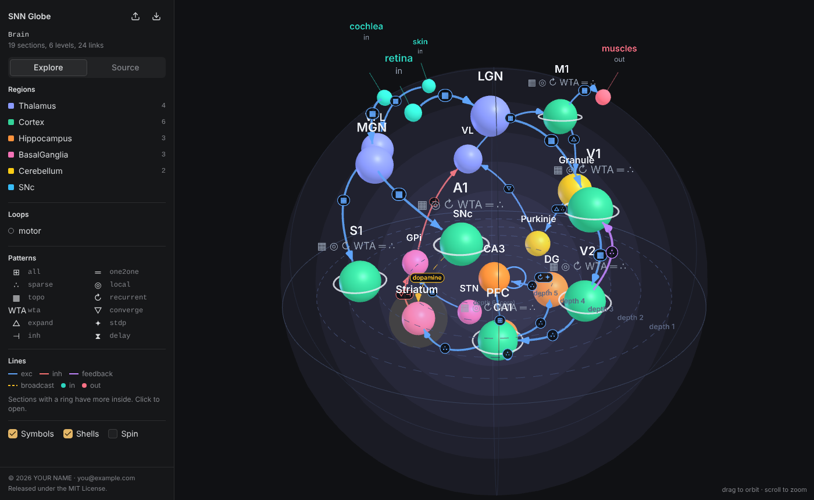
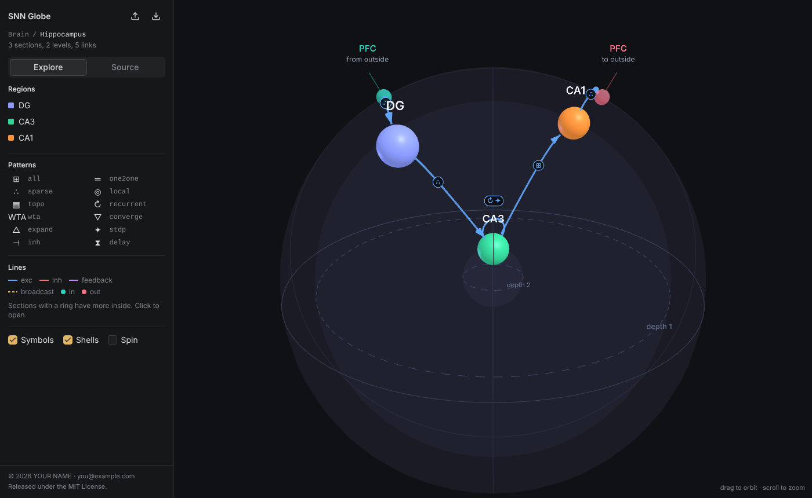
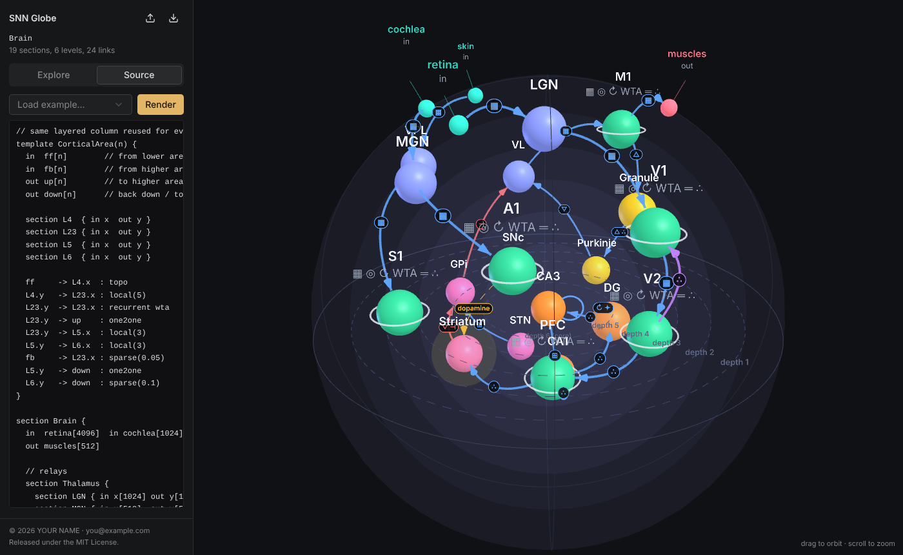

# SNN Globe

A little text format for sketching out spiking neural networks, plus a 3D viewer that turns it into a globe you can spin around.

The idea: inputs and outputs live up top, and stuff sinks toward the middle the further it gets from them. So the deep processing ends up in the core. Sections can hold other sections, and you can click into any of them to get its own globe.



## Try it

```bash
npm install
npm run dev
```

Then hit http://localhost:3000. The Source tab is where you write stuff, and Render (or Ctrl+Enter) draws it.

Clicking into a section gives it its own globe. Anything wired in from outside shows up as a port on top:



## Writing networks

Here's a small one:

```
section Vision {
  in  retina[784]
  out features[64]

  section Edges   { in x[784] out y[256] }
  section Memory  { in x[256] out y[256] }

  retina   -> Edges.x  : local(3x3)
  Edges.y  -> Memory.x : sparse(0.1) stdp
  Memory.y -> Memory.x : recurrent inh delay(2ms)
  Memory.y -> features : all
}
```

The pieces:

- `section Name { ... }`: a chunk of the network. Nest them as deep as you want.
- `in name[size]` / `out name[size]`: ports. Size is optional and just changes how big the ball is.
- `A -> B : tags`: wire two things together. Always section to section, never single neurons.
- `A <-> B`: both ways.
- `A ~> B`: a broadcast, for stuff like dopamine that washes over a whole area.
- `loop name { ... }`: give a loop a name so you can light it up in the viewer.
- `template Name(n) { ... }`: a reusable block, used like `section V1 : Name(4096)`.
- `// comments` work too.

Names get looked up from wherever you write the connection, so `V1.ff` finds `V1` somewhere inside the current section and grabs its `ff` port. If a section has no ports and just holds other sections, it shows up as a colored region.

Tags you can put on a connection:

| tag | looks like | means |
|---|---|---|
| `all` | ⊞ | everything to everything |
| `one2one` | ═ | one to one |
| `sparse(p)` | ∴ | random, with chance p |
| `local(k)` | ◎ | just the neighbors |
| `topo` | ▦ | keeps the spatial map |
| `recurrent` | ↻ | loops back into itself |
| `wta` | WTA | winner takes all |
| `converge` | ▽ | many into few |
| `expand` | △ | few into many |
| `stdp` | ✦ | learns |
| `inh` | ⊣ | inhibitory (otherwise it's excitatory) |
| `delay(t)` | ⧗ | delayed |

Make up your own tags if you want. They just show up as text.

Line colors: blue is excitatory, red is inhibitory, purple is feedback (anything going into a port that starts with `fb`), and dashed gold is a broadcast.



## Saving and sharing

The download button gives you two options:

- **.html**: one file with the viewer and your network baked in. Send it to someone, they double-click it, and it opens in their browser. No install, and it works offline.
- **.snn**: just the text.

To open something, use the upload button or drop a file anywhere on the page. It takes `.snn`, `.txt`, or one of the `.html` files from above, and pulls the network back out of it.

Everything runs in your browser. `npm run build` spits out a plain static site in `out/`, with no server doing any work, so nothing you open ever gets uploaded anywhere. There are a few sanity limits (1 MB files, 20k sections total, 400 per level) so a weird file can't freeze your tab.

## How the layout works

Depth is just how many hops a section is from the nearest port. Each depth gets its own shell, and if one section ends up alone at the bottom it goes right in the center. Then a quick physics pass pulls connected things together and spreads everything else out, without letting anything leave its shell.

## Where stuff lives

```
app/            next.js entry
components/     viewer, side panel, tooltip
components/ui/  shadcn bits
lib/dsl/        parser and section tree
lib/layout.ts   globe layout
lib/scene/      three.js drawing
lib/embed/      the standalone .html viewer
lib/files.ts    upload and download
lib/site.ts     your name, email, links
```

The .html export uses `public/embed.js`. That gets rebuilt whenever you run dev or build, or by hand with `npm run embed`.

## License

MIT, so do whatever you want with it. If you use it or the syntax for something, a shoutout or link back would be awesome. There's a `CITATION.cff` if you need to cite it properly.

Made with some help from Claude Code.
